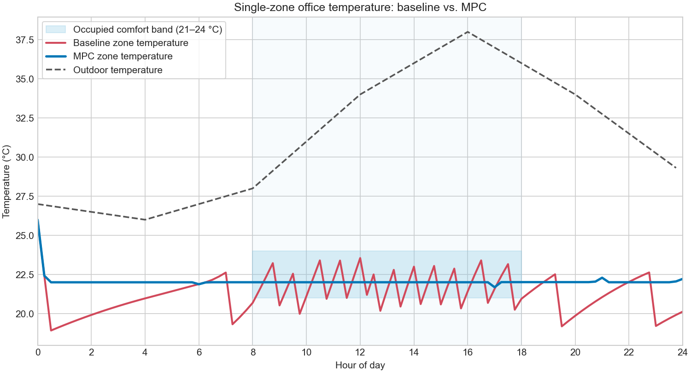
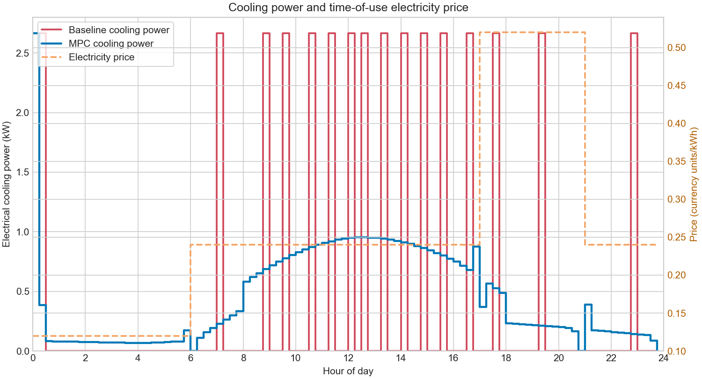

# HVAC Model Predictive Control (MPC) Simulation

This project implements a **Model Predictive Control (MPC)** strategy for an HVAC system to optimize thermal comfort and minimize energy costs based on time-varying electricity prices.

## 🚀 Key Features
- **Mathematical Optimization:** Uses `cvxpy` to solve a convex optimization problem at every time step.
- **Dynamic Cost Integration:** Considers fluctuating electricity prices to shift cooling/heating loads to cheaper periods.
- **Thermal Comfort Constraints:** Ensures indoor temperature remains within a predefined comfort zone.
- **Data-Driven Results:** Visualizes temperature profiles and power consumption vs. price.

## 🛠️ Technologies Used
- **Python 3.x**
- **Libraries:** `cvxpy` (Optimization), `numpy` (Math), `pandas` (Data), `matplotlib` (Visualization).

## 📊 Results & Performance
The system successfully maintains temperature within constraints while significantly reducing costs by leveraging price dips.

### Temperature Profile

### Power Consumption vs. Electricity Price

## 📈 Summary Data
| Time Step | Temperature (°C) | Power (kW) | Price (Toman/kWh) |
|-----------|------------------|------------|------------------|
| *Refer to `results_summary.csv` for full data* | | | |

## 📋 How to Run
1. Install dependencies: `pip install cvxpy numpy pandas matplotlib`
2. Run the simulation: `python project_mpc_hvac.py`
